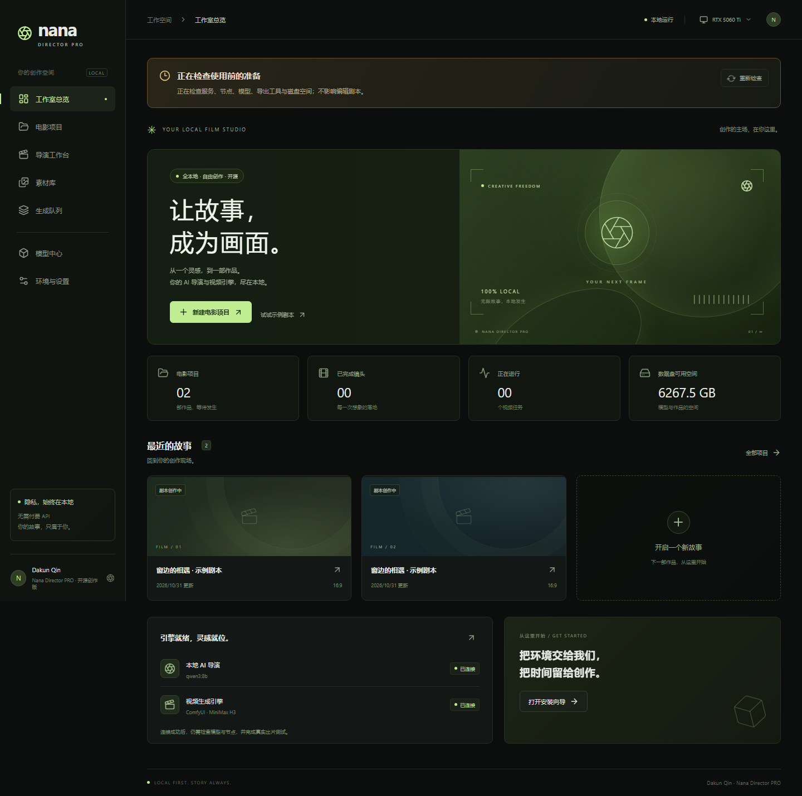

# Nana Director PRO

**完全本地的开源 AI 导演工作室 · v0.1.22 · Windows x64 预览版**

从剧本、分镜和素材，到 ComfyUI 视频生成、审片与成片导出，在自己的设备上完成。剧本规划使用本地 Ollama 模型，不使用付费大模型 API，不自动回退云端。

[下载最新版](https://github.com/dakunqin/Nana-Director-Pro/releases/latest) · [完整使用手册](docs/USER_GUIDE.zh-CN.md) · [文档导航](docs/README.md) · [安装](docs/INSTALLATION.zh-CN.md) · [排错](docs/TROUBLESHOOTING.zh-CN.md)



## 主要功能

- 本地剧本分析、结构化分镜、人工编辑与锁定；支持剧本 TXT/MD/JSON、分镜 JSON/CSV 导入。
- 分镜上下拖动到任意位置、选择记忆；画面比例、MP、采样器、步数与输出帧率设置。
- H3 文生视频、参考图、首帧图生视频与自动模式；可选择其他镜头尾帧衔接。
- 人物、动物、场景、道具四视图草稿；FLUX.2 Klein 参考编辑、SDXL 兼容路线，审核后入库。
- 参考图上传、素材管理与删除；H3 原生声音默认开启，可单镜头选择无声。
- 串行视频队列、任务耗时、工作流查看、历史恢复、监视器审片。
- 本地 FFmpeg 导出 MP4，默认以项目名下载；项目 ZIP 备份。
- 环境安装、服务检测反馈、模型按需下载/续传/校验及自定义模型导入。
- 顶栏整机性能与队列状态、六种界面风格、六种语言与系统语言默认选择。
- 默认关闭的本地 Agent API，独立令牌、权限、项目版本与幂等提交。

## 下载与首次运行

普通用户在 [Releases](https://github.com/dakunqin/Nana-Director-Pro/releases) 下载：

| 附件 | 用途 |
| --- | --- |
| `x64-setup.exe` | Windows 安装版 |
| `x64-portable.exe` | Windows 便携版，每次启动先解包 |
| `docs.zip` | 完整中文文档和离线 HTML 手册 |
| `source.zip` | 开发者源码快照 |
| `SHA256SUMS` | 发布文件完整性校验 |

1. 启动程序，等待启动小窗口和主界面资源检测。
2. 设置中选择数据盘，安装托管环境，或填写已有本机 ComfyUI/Ollama 地址。
3. 模型中心下载本地导演模型和 H3 基础五模型；图片素材生成需要另外准备图片套件。
4. 创建项目或打开示例，写/导入剧本，保存并规划或导入分镜。
5. 为角色绑定参考图，检查声音、引用、生成方式和尾帧。
6. 先验证一个短镜头，审片后继续批量生成，最后导出并点击下载成片。

程序包不含模型。H3 五个基础权重合计约 **57.5 GB**，还需运行环境、缓存、图片/导演模型和作品空间。基础路线至少先留约 80 GB，可用容量仍应以实际所选资源为准。

首次下载需要网络，资源齐全后核心流程离线运行。主动连接局域网后端时，生成发生在该设备。桌面版默认数据在 `%APPDATA%\Nana Director PRO\StudioData`；自定义数据盘以设置为准。选择新数据盘不会自动迁移旧数据。

## v0.1.22 更新

- 修复便携启动等待图格式，恢复启动提示；主程序提供动画等待窗。
- 修复历史任务存在、当前项目无分镜时打开示例导致黑屏。
- 示例入口复用同一项目，安全合并未修改、未使用的重复副本。
- 新增左下角关于页，集中版本、作者信息及 PayPal/微信自愿捐赠二维码。

上一版新增项目名成片下载、标题行导入入口和分镜拖动排序。详见 [版本说明](docs/RELEASE-0.1.22.md)。

## 平台与验证范围

Windows 10/11 x64 + NVIDIA 为托管环境首要目标。无独显可编辑与尝试 CPU 规划；不承诺 H3 CPU 性能。Linux/macOS 可尝试核心服务源码运行，桌面托管全流程未声明通用支持。

v0.1.22 已通过 **93 项服务端测试、45 项界面测试**，以及精简桌面启动、FFmpeg 导出/尾帧、备份、离线语言和二维码检查；最终便携 EXE 另做了启动与示例流程复核。

资源就绪不等于所有 GPU 的推理、速度和画质验收。没有记录通用硬件兼容矩阵，参考图与尾帧也不是严格身份锁。完整事实与边界见 [验证报告](docs/VALIDATION.md)。

## 开发者

需要 Node.js **22.13+**，推荐 Node 24 LTS。

```powershell
npm.cmd ci
npm.cmd run prepare:tools
npm.cmd run build
npm.cmd start
```

浏览器打开 `http://127.0.0.1:8797`。开发模式不会自动开始大型模型下载。

```powershell
npm.cmd test
node scripts/check-ui-locales.mjs
npx.cmd playwright install chromium
npm.cmd run test:ui
npm.cmd run desktop
npm.cmd run dist:win
```

更多：[开发指南](docs/DEVELOPMENT.zh-CN.md) · [架构](docs/ARCHITECTURE.md) · [Agent](docs/AGENT.md) · [OpenAPI](docs/openapi.json) · [发布指南](docs/RELEASE_GUIDE.zh-CN.md) · [贡献](CONTRIBUTING.md)。

## 开源、作者与支持

作者 **Dakun Qin** · qindakun@yahoo.com。软件关于页可查看 PayPal/微信二维码，自愿捐赠支持维护，不影响软件功能。

本项目是独立开源实现，基础 H3 图改编自 [nawusijia/Nana_Animation_auto](https://github.com/nawusijia/Nana_Animation_auto)，不是上游官方发行版。自有代码采用 MIT；ComfyUI、社区节点、模型、FFmpeg 等各适用其许可。模型商用与再分发以模型许可为准，不能用代码 MIT 代替。完整来源和声明见 [THIRD_PARTY_NOTICES.md](THIRD_PARTY_NOTICES.md)。
